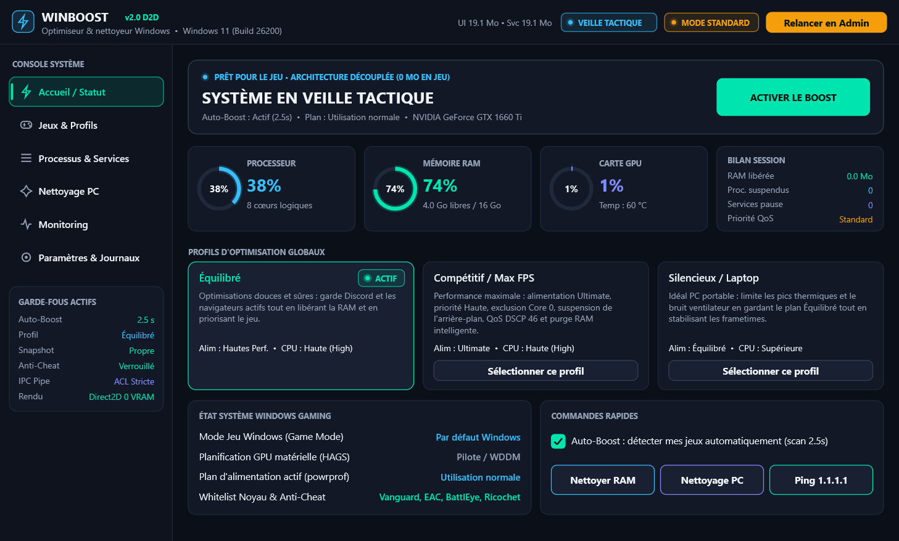

# WinBoost

Utilitaire système natif pour Windows 10 et Windows 11 (x64), écrit en Rust avec une architecture découplée et une interface Win32 / Direct2D / DirectWrite. Conçu pour optimiser l'environnement d'exécution pendant les sessions de jeu tout en garantissant une réversibilité complète des modifications système.



---

## Principes de conception

- **Architecture découplée** : séparation stricte entre le daemon d'arrière-plan (`winboost-svc.exe`) et l'interface graphique (`winboost-ui.exe`). Lorsque la fenêtre est fermée, le processus UI se termine complètement (`0 Mo` RAM, `0 %` GPU/VRAM en jeu) tandis que le daemon reste actif dans la barre des tâches.
- **Zéro WebView, zéro OpenGL** : interface rendue nativement via Win32 + Direct2D + DirectWrite (~22 Mo RAM fenêtre ouverte, ~1,2 Mo par binaire release).
- **Réversibilité et Crash-Recovery** : avant toute optimisation, l'état initial du système est enregistré de manière atomique (`MoveFileExW` + `sync_all`) dans `recovery_state.json`, puis restauré à la fermeture du jeu, à l'arrêt du boost ou automatiquement au redémarrage en cas d'arrêt brutal.
- **100 % local** : aucune télémétrie, aucune requête réseau externe (hors tests Ping ICMP initiés par l'utilisateur).

---

## Architecture

```text
.
├── Cargo.toml                  # Package winboost + 2 binaires (winboost-svc, winboost-ui)
├── app.manifest                # Manifeste standard (asInvoker, DPI PerMonitorV2)
├── app.admin.manifest          # Manifeste optionnel (requireAdministrator)
└── src/
    ├── lib.rs                  # Modules partagés
    ├── bin/
    │   ├── winboost_svc.rs     # Daemon (Tray, Auto-Boost, serveur Named Pipe, Crash-Recovery)
    │   └── winboost_ui.rs      # Interface Win32 / Direct2D lancée à la demande
    ├── ipc.rs                  # Protocole JSON sur Named Pipe sécurisé (\\.\pipe\WinBoost)
    ├── engine.rs               # Orchestration BoostEngine et restauration inverse
    ├── win32_ops.rs            # Appels Win32 / NTDLL / PowrProf / SCM / Registry / ICMP
    ├── whitelist.rs            # Liste blanche inviolable (noyau Windows, pilotes, Anti-Cheat)
    ├── recovery.rs             # Persistance atomique et validation anti-tampering
    ├── monitoring.rs           # Télémétrie CPU / RAM / GPU (nvml.dll chargé depuis System32)
    ├── cleaner.rs              # Analyse et nettoyage de fichiers temporaires et caches
    ├── tray.rs                 # Icône et menu contextuel System Tray
    ├── ui.rs                   # Rendu Direct2D / DirectWrite (6 onglets)
    └── self_test.rs            # Vérification automatisée (--self-test)
```

---

## Sécurité et garde-fous

- **IPC durci** : le Named Pipe `\\.\pipe\WinBoost` applique une ACL SDDL stricte (`SYSTEM`, `Administrators`, propriétaire de session uniquement), `PIPE_REJECT_REMOTE_CLIENTS` (blocage SMB distant), `FILE_FLAG_FIRST_PIPE_INSTANCE` (anti-pipe squatting) et une validation stricte de chaque requête côté service.
- **Liste blanche inviolable** : les processus critiques Windows (`csrss.exe`, `lsass.exe`, `dwm.exe`, `svchost.exe`, etc.), les pilotes GPU/Audio, les logiciels de périphériques et les systèmes Anti-Cheat (`vgc.exe`, `EasyAntiCheat`, `BEService`, `BEDaisy`, `Ricochet`, `FaceIT`, etc.) ne peuvent jamais être suspendus, fermés ou modifiés.
- **Protection anti-recyclage de PID** : l'empreinte `FILETIME` (`GetProcessTimes`) est vérifiée avant toute reprise (`NtResumeProcess`) ou restauration de priorité/affinité CPU.
- **Priorité CPU plafonnée** : la priorité `Realtime` est volontairement exclue (plafond à `High`).
- **Validation du fichier de reprise** : lors de la restauration, les entrées de `recovery_state.json` sont filtrées par allowlist registre, validation stricte des GUID d'alimentation, des noms QoS (`WinBoost_*`) et des services non critiques.
- **Chargement sécurisé des DLL** : `nvml.dll`, `powrprof.dll` et `iphlpapi.dll` sont chargés exclusivement via `LoadLibraryExW` avec `LOAD_LIBRARY_SEARCH_SYSTEM32` (protection contre le DLL Hijacking).
- **Nettoyage sûr** : le module de nettoyage ignore les liens symboliques et jonctions NTFS (`!is_symlink()`), limite la profondeur de parcours et ignore les fichiers verrouillés sans erreur.

---

## Compilation et installation

### Prérequis

- Windows 10 ou Windows 11 (x64)
- Chaîne d'outils Rust (`x86_64-pc-windows-msvc`)

### Build Release standard (élévation UAC à la demande)

```powershell
cargo build --release
```

Les deux exécutables sont générés dans `target/release/` :
- `winboost-ui.exe`
- `winboost-svc.exe`

> **Important** : `winboost-ui.exe` et `winboost-svc.exe` doivent impérativement être placés dans le **même répertoire**. Au lancement, `winboost-ui.exe` démarre automatiquement `winboost-svc.exe` s'il n'est pas déjà actif.

### Build avec élévation Administrateur par défaut

```powershell
cargo build --release --features uac-admin
```

---

## Utilisation

### Démarrage rapide

1. Lancer `winboost-ui.exe`.
2. Choisir un profil global dans l'onglet **Accueil / Statut** (`Équilibré`, `Compétitif / Max FPS`, ou `Silencieux / Laptop`).
3. Cliquer sur **Activer le Boost** pour un déclenchement manuel, ou laisser **Auto-Boost** détecter automatiquement le lancement d'un jeu (scan toutes les 2,5 s) et restaurer l'état initial à sa fermeture.
4. Cliquer sur la croix ferme uniquement l'interface : le daemon reste disponible dans la zone de notification Windows (clic droit sur l'icône pour activer/désactiver le boost, changer de profil, rouvrir le tableau de bord ou quitter avec restauration complète).

### Privilèges Standard vs Administrateur

L'application fonctionne en mode **Standard** pour les fonctions courantes (plan d'alimentation, Mode Jeu Windows, priorité/affinité CPU, suspension/fermeture de processus utilisateur, nettoyage `%TEMP%` / shaders / corbeille).

Le mode **Administrateur** (via le bouton **Relancer en Admin** ou la feature `uac-admin`) débloque en plus :
- La mise en pause temporaire des services Windows non essentiels (`WSearch`, `SysMain`, `BITS`, `DoSvc`, `Spooler`, etc.).
- L'application de stratégies QoS DSCP 46 sur le trafic du jeu.
- La purge de la *Standby List* RAM (`NtSetSystemInformation`).
- Le nettoyage de `C:\Windows\Temp` et du cache Windows Update (`SoftwareDistribution\Download`).

### Description des onglets

1. **Accueil / Statut** : contrôle Boost ON/OFF, jauge CPU/RAM/GPU en temps réel, bilan de session, sélection du profil actif et raccourcis rapides.
2. **Jeux & Profils** : bibliothèque de jeux préconfigurés, ajout d'exécutables personnalisés (`.exe`) ou de dossiers surveillés, et surcharges par jeu (priorité, exclusion du Core 0).
3. **Processus & Services** : vue des processus actifs avec empreinte RAM, règles par application (`Ignorer`, `Suspendre`, `Fermer proprement`), services Windows configurables et gestion de la liste blanche utilisateur.
4. **Nettoyage PC** : analyse préalable de l'espace récupérable sur 6 catégories (`%TEMP%`, `Windows\Temp`, caches shaders NVIDIA/AMD/DirectX, cache Windows Update, Corbeille, fichiers `.log`/`.dmp` de plus de 7 jours) puis nettoyage sélectif.
5. **Monitoring** : courbes historiques CPU, RAM et GPU + testeur de latence ICMP natif IPv4/IPv6 (`1.1.1.1`, `8.8.8.8`, `9.9.9.9` ou hôte personnalisé) avec min/moy/max, gigue et perte de paquets.
6. **Paramètres & Journaux** : démarrage avec Windows, seuil de purge Standby List, gestion manuelle du snapshot de récupération et journal horodaté des actions.

### Options en ligne de commande

```powershell
# Vérification automatisée bout-en-bout (génère un rapport JSON)
.\winboost-ui.exe --self-test self_test_report.json

# Capture de l'interface sans voler le focus
.\winboost-ui.exe --screenshot preview.png
```

---

## Données locales

Toutes les données de configuration et d'état sont stockées dans `%LOCALAPPDATA%\WinBoost\` :
- `config.json` : profils, jeux suivis, règles processus/services et préférences.
- `recovery_state.json` : présent uniquement pendant une session de boost active ou un snapshot manuel ; supprimé automatiquement après restauration complète.

---

## Tests

```powershell
cargo check --all-targets
cargo test
```
